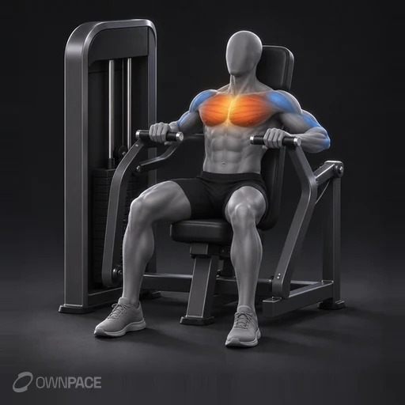
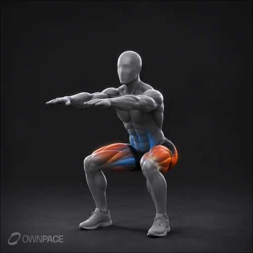
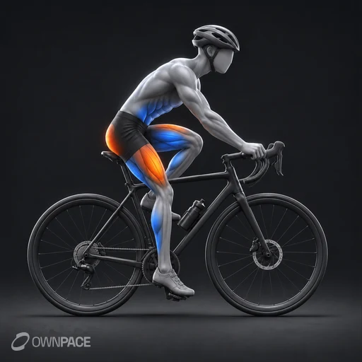
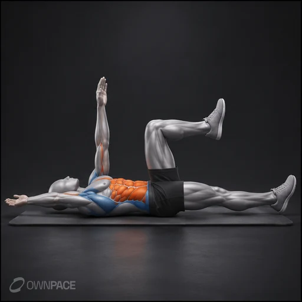

# OWNPACE Exercise Dataset

**65 exercises · 195 source poses · 512 × 512 PNG masters and optimized WebP · English · v0.1.0 candidate**

   

A file-based library prepared for OWNPACE fitness app development. No API key, database or server needed. Includes original supplied images, independently authored draft exercise descriptions, muscle labels, equipment and form cues. This is a development candidate, not a certified exercise guide or a cleared public dataset.

## Contents

| Category | Exercises | Frames |
|---|---:|---:|
| Strength | 50 | 150 |
| Cardio | 9 | 27 |
| Mobility | 2 | 6 |
| Stretching | 4 | 12 |
| Total | 65 | 195 |

- `exercises.json`: complete manifest, one entry per exercise.
- `exercises.csv`: tabular export for editing/import.
- `exercise/<id>/index.json`: individual exercise records.
- `images/original/`: 195 untouched source PNGs.
- `images/webp/`: 195 optimized WebP copies, same dimensions and framing.
- `index.html`: standalone responsive, searchable visual catalog; open directly in a browser.
- `qa/`: image hashes, source batch manifests/reports, and review notes.
- `schema/`: JSON schema.
- `scripts/validate.py`: validation for records, paths, dimensions and original checksums.

## Quickstart

Use the local JSON and images inside an app, or serve the repository as static files. Paths are relative to the repository root, including in individual exercise JSON files.

```js
const base = new URL('./', window.location.href);
const data = await fetch(new URL('exercises.json', base)).then(r => {
  if (!r.ok) throw new Error('Dataset unavailable');
  return r.json();
});
const exercise = data.exercises.find(e => e.id === 'chest-press-machine');
const imageUrl = new URL(exercise.images.ownpace.a, base).href;
```

```python
import json
from pathlib import Path

data = json.loads(Path('exercises.json').read_text())
for exercise in data['exercises']:
    print(exercise['id'], exercise['primary_muscles'])
```

### Schema

Each record has a stable slug `id`, `name_en`, `description_en`, `category`, `body_part`, `equipment`, `equipment_list`, `primary_muscles`, `secondary_muscles`, `difficulty`, `force_type`, `mechanic`, `motion_type`, `instructions_en`, `tips_en`, `is_bodyweight`, `is_unilateral`, `images`, `frame_order`, `qa` and `source_batch`.

`images.ownpace` contains WebP paths keyed `a`, `b`, `c`; `images.original` contains corresponding PNG paths. These are source poses, not universally start/mid/peak. `motion_type` is `repetition`, `cycle` or `hold`; use a pose selector rather than assuming a reverse loop is anatomically correct. Muscle tags describe intended training targets; they are not validated against every highlighted pixel. `is_bodyweight` refers to resistance, not absence of a support. No MET values or translations are supplied because they have not been validated.

## Validation and QA

```sh
python -m pip install -r requirements.txt
python scripts/validate.py
```

Technical validation is distinct from exercise-form review. All assets are candidate imagery. Review each exercise against the intended pose, anatomy, equipment, muscle map and continuity before production; do not present a generated pose sequence as actual captured motion. See [QA notes](qa/README.md).

## Publishing

Create a **private** GitHub repository named `ownpace-exercise-dataset`, then upload the contents of this folder (not the ZIP itself). See [PUBLISHING.md](PUBLISHING.md). Do not enable a public website or publish a public release until rights and content review are complete. No public redistribution license has been chosen. See [RIGHTS.md](RIGHTS.md).

Repository architecture was informed by [RepDB/exercise-dataset](https://github.com/RepDB/exercise-dataset). No RepDB code, metadata or image files were imported into this package. This is not an exact RepDB schema replacement or an affiliated project. Image provenance must be independently confirmed before redistribution.
